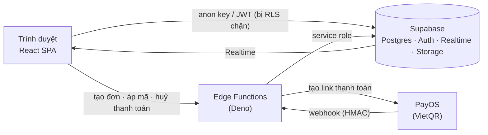

<p align="center">
  
</p>

<h1 align="center">Sagori · SnackHub</h1>

<p align="center">
  Web đặt đồ ăn vặt, <b>giao tận lớp</b> trong khuôn viên trường đại học.<br />
  Thiết kế <b>mobile-first</b> — đặt hàng không cần đăng nhập, thanh toán VietQR (PayOS) hoặc tiền mặt, quán tự bật/tắt từng phương thức.
</p>

---

**Sagori** (tên mã dự án: **SnackHub**) là ứng dụng web cho một quán đồ ăn vặt trong trường. Phần lớn khách đặt bằng điện thoại giữa giờ học nên giao diện ưu tiên mobile. Khách chọn món, tuỳ biến topping, áp mã giảm giá rồi đặt giao tới toà A, toà B hoặc khuôn viên (giao tại tầng 1), hoặc tự đặt tại quầy bằng cách quét mã QR. Quán và nhân viên quản lý toàn bộ qua khu vực `/admin`.

Quán chỉ nhận đơn trong khung giờ cấu hình (mặc định **6:00–18:00**). Hệ thống **không quản lý tồn kho theo số lượng** — chỉ có cờ còn hàng / hết hàng tạm thời cho từng món và combo.

- [Tính năng](#tính-năng)
- [Công nghệ](#công-nghệ)
- [Kiến trúc](#kiến-trúc)
- [Cấu trúc thư mục](#cấu-trúc-thư-mục)
- [Bắt đầu nhanh](#bắt-đầu-nhanh)
- [Biến môi trường](#biến-môi-trường)
- [Lệnh thường dùng](#lệnh-thường-dùng)
- [Edge Functions](#edge-functions)
- [Bảo mật và phân quyền](#bảo-mật-và-phân-quyền)
- [Triển khai](#triển-khai)
- [Quy ước phát triển](#quy-ước-phát-triển)
- [Tài liệu liên quan](#tài-liệu-liên-quan)

## Tính năng

### Khách hàng (không cần đăng nhập)

- **Xem menu:** banner, combo, danh mục, các dải Flash Sale / Must Try / Ăn Ngon Rẻ; tìm kiếm không dấu.
- **Tuỳ biến món:** nhóm tuỳ chọn (bắt buộc / tối đa) và topping; combo giá ưu đãi.
- **Giỏ hàng** lưu trên máy, áp mã giảm giá, mua lại đơn cũ một chạm.
- **Hai cách đặt:**
  - *Giao tận nơi* — chọn toà A, B hoặc Khuôn viên (giao tại tầng 1), có thể hẹn giờ nhận trong ngày.
  - *Tự đặt tại quầy* — quét mã QR dẫn tới `?mode=in_store`: không phí giao, không cần số điện thoại.
- **Thanh toán:** VietQR (PayOS) hoặc tiền mặt, tuỳ phương thức quán đang bật cho từng hình thức đặt (mặc định: giao tận nơi chỉ VietQR; tại quầy VietQR hoặc tiền mặt).
- **Theo dõi đơn** bằng mã đơn tại `/don-hang/:mã`, trạng thái cập nhật realtime; tự huỷ được khi đơn còn "Chờ xác nhận".

### Nhân viên

Tài khoản có hồ sơ nhân sự nhưng không phải superadmin chỉ thấy **ba mục** và được đưa thẳng tới *Lịch của tôi* sau khi đăng nhập:

- **Đơn hàng** — xử lý đơn realtime, chuông báo đơn mới, cảnh báo trễ hạn (SLA).
- **Chấm công** — check-in / check-out kèm ảnh selfie và GPS, giới hạn trong bán kính quanh quán.
- **Lịch của tôi** — ca được gán, giờ công theo tháng, gửi yêu cầu xin nghỉ / đổi ca; có popup nhắc check-in khi sắp tới ca.

### Quản trị viên (superadmin)

Toàn quyền trên `/admin/*`:

| Mục | Chức năng |
|---|---|
| Thống kê | Doanh thu, số đơn, biểu đồ, tỷ lệ trễ SLA, tỷ trọng giao tận nơi / tại quầy, khách hàng top, tỷ lệ quay lại |
| Đơn hàng | Toàn bộ đơn, cập nhật trạng thái, xác nhận thu tiền COD, tìm theo số điện thoại |
| Thực đơn, Combo, Topping | Món và danh mục, ảnh (Supabase Storage), bật/tắt còn hàng, combo giá ưu đãi, nhóm tuỳ chọn |
| Khuyến mãi | Mã giảm giá theo % hoặc số tiền, đơn tối thiểu, mức giảm tối đa, hạn dùng, giới hạn lượt |
| Banner, Trang chủ | Banner có liên kết và thứ tự; bật/tắt từng khối trang chủ |
| Cài đặt quán | Đóng/mở thủ công, **mở nhận đơn ngay** (bỏ qua khung giờ đến hết ngày), khung giờ, phí giao, đơn tối thiểu, toạ độ và bán kính chấm công, **bật/tắt phương thức thanh toán** cho đơn giao tận nơi và đơn tại quầy |
| Nhân sự | Tạo tài khoản nhân viên, lương theo giờ, khoá/mở hồ sơ, xác nhận bảng lương |
| Ca làm | Lưới xếp ca theo tuần, duyệt yêu cầu xin nghỉ / đổi ca |
| Chấm công | Lịch sử vào/ra kèm ảnh, thống kê đi trễ / về sớm |

**Chưa có:** in hoá đơn nhiệt 80mm cho trang quản lý đơn (đang trong kế hoạch).

## Công nghệ

| Lớp | Công nghệ |
|---|---|
| Frontend | React 18, Vite 6, TypeScript 5 (strict), React Router 7 |
| State và validate | Zustand 5 (`persist` cho giỏ hàng), Zod 3 |
| Giao diện | Tailwind CSS 3 với token Material Design 3 (CSS variables), `motion`, `lucide-react`, Recharts; font Plus Jakarta Sans |
| Backend | Supabase: Postgres 17 (RLS), Auth, Realtime, Storage, Edge Functions (Deno), `pg_cron` |
| Thanh toán | PayOS (VietQR) hoặc tiền mặt (COD), bật/tắt theo hình thức đặt; mã QR hiển thị bằng `qrcode.react` |
| Phát hành | Frontend: static server Node (`server.js`) trên hosting Plesk/Passenger. Backend: Supabase CLI |

## Kiến trúc



Những nguyên tắc định hình kiến trúc:

- **Client không quyết định giá.** Frontend chỉ gửi `product_id`, `option_ids`, `quantity`; Edge Function `create-order` tra lại giá từ database và tính tổng tiền. Sửa giỏ hàng trong localStorage không đổi được số tiền phải trả.
- **`SERVICE_ROLE_KEY` chỉ nằm ở Edge Function.** Frontend chỉ dùng anon key, mọi truy cập đều đi qua RLS.
- **Đơn hàng lưu snapshot.** `order_items` giữ tên món, tuỳ chọn, giá tại thời điểm đặt; combo giữ danh sách món con (`combo_items_snapshot`).
- **Realtime hai kênh.** Admin nghe Postgres Changes trên `orders` (chuông, badge, danh sách). Khách nghe Broadcast công khai trên kênh `order:<mã đơn>`, payload chỉ có mã đơn và trạng thái.
- **Tác vụ định kỳ bằng `pg_cron`:** huỷ đơn PayOS treo, dọn bảng rate limit, dọn ảnh chấm công quá 30 ngày.

## Cấu trúc thư mục

```
.
├── src/
│   ├── pages/            # Màn hình khách; pages/admin/ cho khu vực quản trị
│   ├── components/       # UI dùng chung: home, product, cart, checkout, order, ui, admin
│   ├── routes/           # RootLayout, AppLayout (khách), AdminLayout (kiểm tra quyền, sidebar)
│   ├── hooks/            # useAdminSession, useOrderNotification (Realtime), useAsync...
│   ├── store/            # Zustand: cart, orderMode, profile, recentOrders, toast
│   ├── lib/              # Truy vấn Supabase, Zod schema (checkoutSchema), env
│   ├── types/database.ts # Kiểu dữ liệu của database
│   └── index.css         # Bảng màu (CSS variables) — nguồn sự thật của màu
├── supabase/
│   ├── functions/        # Edge Functions + _shared (Zod schema, PayOS, CORS)
│   ├── migrations/       # Migration SQL
│   └── config.toml       # Cấu hình verify_jwt của từng function
├── scripts/              # contrast.mjs (đo tương phản WCAG), test-payos-webhook.ts
├── public/               # Logo, âm báo đơn mới, .htaccess
├── server.js             # Static server + SPA fallback cho hosting Node
├── CLAUDE.md             # Quy tắc thiết kế và nghiệp vụ
└── RUNBOOK.md            # Vận hành, deploy, xử lý sự cố
```

Alias `@/` trỏ tới `src/`.

## Bắt đầu nhanh

**Yêu cầu:** Node.js 20 trở lên (khuyến nghị bản LTS), npm, và một project Supabase dành cho dev **đã có schema** (xem lưu ý bên dưới).

```bash
git clone https://github.com/mastercode-viet/snackhub-food-ordering.git
cd snackhub-food-ordering
npm install
```

Tạo `.env.local` ở thư mục gốc (lấy giá trị ở Supabase Dashboard → Project Settings → API):

```dotenv
VITE_SUPABASE_URL=https://<project-ref>.supabase.co
VITE_SUPABASE_ANON_KEY=<anon / publishable key>
```

```bash
npm run dev      # http://localhost:5173
```

- Vite chạy cố định cổng **5173** (`strictPort`): Edge Function kiểm tra CORS theo origin, đổi cổng là đổi origin và đặt hàng sẽ bị chặn cho tới khi cập nhật `ALLOWED_ORIGINS`.
- Thiếu hoặc sai biến `VITE_*` thì app báo lỗi rõ ràng ngay khi khởi động (`src/lib/env.ts`).
- **Tài khoản quản trị đầu tiên:** tạo người dùng trong Supabase Authentication rồi thêm `user_id` vào bảng `admins`. Các nhân viên sau đó tạo tại `/admin/nhan-su`.

> **Lưu ý về database.** `supabase/migrations/` chỉ chứa các thay đổi từ 18/09/2026 trở đi (nhân sự, chấm công, ca làm, giờ hẹn, đặt tại quầy...) và **chưa có schema nền** (đơn hàng, thực đơn, combo, mã giảm giá...). Vì vậy chưa thể dựng database mới từ con số 0 chỉ bằng `supabase db push`. Hãy dùng project Supabase dev đã có sẵn schema, hoặc `supabase db pull` từ project đó.

## Biến môi trường

**Frontend** (`.env.local` khi dev; khi build phát hành thì đặt lúc build). Mọi biến `VITE_*` bị đóng gói vào bundle trình duyệt nên chỉ chứa giá trị công khai.

| Biến | Ghi chú |
|---|---|
| `VITE_SUPABASE_URL` | URL project Supabase |
| `VITE_SUPABASE_ANON_KEY` | Khoá anon/publishable — an toàn để lộ vì mọi truy cập bị RLS chặn |

**Edge Functions** — mẫu ở [`supabase/functions/.env.example`](supabase/functions/.env.example); đặt lên cloud bằng `supabase secrets set`, không commit giá trị thật.

| Biến | Dùng cho |
|---|---|
| `ALLOWED_ORIGINS` | Origin được phép gọi function (CORS), cách nhau bằng dấu phẩy |
| `PUBLIC_SITE_URL` | URL site, dùng làm `returnUrl` / `cancelUrl` của PayOS |
| `PAYOS_CLIENT_ID`, `PAYOS_API_KEY`, `PAYOS_CHECKSUM_KEY` | Khoá PayOS; checksum key dùng để verify chữ ký webhook |
| `SUPABASE_URL`, `SUPABASE_ANON_KEY`, `SUPABASE_SERVICE_ROLE_KEY` | Runtime tự cấp khi deploy; chỉ khai báo khi chạy local bằng `supabase functions serve` |

> Không bao giờ đặt `SERVICE_ROLE_KEY` hay khoá PayOS ở frontend hoặc trong biến `VITE_*`.

## Lệnh thường dùng

| Lệnh | Tác dụng |
|---|---|
| `npm run dev` | Chạy Vite dev server (mở được qua mạng LAN để thử trên điện thoại thật) |
| `npm run typecheck` | `tsc -b --noEmit` — phải sạch lỗi trước khi commit |
| `npm run build` | `tsc -b && vite build`, kết quả ở `dist/` |
| `npm run preview` | Xem thử bản build bằng Vite |
| `npm start` | `node server.js` — phục vụ `dist/` kèm SPA fallback, giống môi trường phát hành |
| `node scripts/contrast.mjs` | Đo tương phản WCAG AA cho các cặp màu nền/chữ, đọc thẳng từ `src/index.css` |
| `supabase functions serve --env-file supabase/functions/.env` | Chạy Edge Functions ở máy local |
| `supabase functions deploy [tên]` | Deploy một hoặc tất cả Edge Function |
| `supabase db push` | Áp các migration chưa có lên project đang `link` |

## Edge Functions

Cấu hình `verify_jwt` nằm ở [`supabase/config.toml`](supabase/config.toml).

| Function | `verify_jwt` | Vai trò |
|---|---|---|
| `create-order` | có | Tạo đơn: validate Zod, kiểm tra giờ mở cửa, chặn phương thức thanh toán quán đang tắt, tra lại giá từ DB, tiêu lượt mã giảm giá (atomic), rate limit theo IP và số điện thoại, tạo link PayOS |
| `apply-discount` | có | Xem trước mức giảm của mã; có rate limit |
| `cancel-payment` | có | Khách bỏ thanh toán PayOS |
| `payos-webhook` | không | Nhận webhook PayOS, bảo mật bằng chữ ký HMAC trong body; idempotent |
| `create-staff-account` | có | Tạo tài khoản nhân viên; tự kiểm tra `is_admin()` của người gọi |
| `purge-attendance-media` | không | `pg_cron` gọi hằng ngày kèm secret; xoá ảnh chấm công quá 30 ngày, giữ lại bản ghi giờ công |

## Bảo mật và phân quyền

- **RLS bật trên mọi bảng.** Khách không có quyền đọc `orders`; chỉ tra được đơn qua RPC bằng mã đơn (UUID).
- **Giá tính ở server**, mã giảm giá trừ lượt bằng atomic update `UPDATE ... SET used_count = used_count + 1 WHERE used_count < max_uses`.
- **Webhook PayOS** verify HMAC-SHA256 trước khi đọc payload, ghi `payos_webhook_events` với khoá duy nhất để gửi trùng không xử lý hai lần.
- **Validate bằng Zod ở cả client và Edge Function.** Ghi chú khách nhập bị chặn `<` `>` và luôn được escape khi hiển thị trên trang quản trị.
- **Rate limit** khi tạo đơn và áp mã; chỉ lưu hash của IP và số điện thoại.
- **Hai hàm DB `is_admin()` và `is_staff()`** dùng chung cho cả giao diện lẫn RLS. Nhân viên bị ẩn menu và chuyển hướng khỏi mọi trang ngoài ba mục được phép — đây chỉ là lớp giao diện, RLS ở database mới là lớp chặn thật.
- Phiên quản trị tự đăng xuất sau 15 phút không thao tác (máy ở quầy dùng chung).

## Triển khai

- **Frontend:** `npm run build` với biến môi trường của đúng project Supabase (biến `VITE_*` được đóng gói lúc build), rồi đưa `dist/` cùng `server.js` lên hosting Node. `server.js` bắt buộc phải có vì PayOS `returnUrl` và các đường dẫn sâu (`/admin/...`, `/don-hang/:mã`) đều là tải trang đầy đủ.
- **Backend:** Edge Functions và migration deploy **riêng** bằng Supabase CLI, không đi cùng việc phát hành frontend.
- **Môi trường:** dev/staging và production dùng hai project Supabase tách biệt (URL, khoá, secrets, dữ liệu riêng). Kiểm tra project đang `link` trước mọi lệnh ghi.

Quy trình chi tiết, cách xử lý sự cố webhook PayOS và bảng tra nhanh nằm trong [RUNBOOK.md](RUNBOOK.md).

## Quy ước phát triển

- Chạy `npm run typecheck` sạch lỗi trước khi commit.
- **Giao diện:** dùng token Tailwind thay vì mã màu hoặc pixel viết cứng; ưu tiên mobile; mọi cặp nền/chữ phải đạt tương phản tối thiểu **4.5:1** — chạy `node scripts/contrast.mjs` sau khi đổi màu.
- **Validate:** mọi input đi qua Zod. Sửa schema phía client (`src/lib/checkoutSchema.ts`) thì sửa luôn bản ở `supabase/functions/_shared/schemas.ts` — hai bên phải khớp nhau.
- **Migration:** thêm file mới `supabase/migrations/<yyyymmddhhmmss>_<tên>.sql`, không sửa file đã áp dụng. Bảng mới phải bật RLS và có policy ngay trong migration. Đổi bảng/cột thì cập nhật `src/types/database.ts`.
- **Commit** theo dạng `feat(phạm-vi): mô tả`, `fix(...)`, `refactor:`, `docs:`, `chore:` — tiếng Việt, ngắn gọn.

## Tài liệu liên quan

| Tệp | Nội dung |
|---|---|
| [CLAUDE.md](CLAUDE.md) | Quy tắc thiết kế và nghiệp vụ của dự án (đồng thời là chỉ dẫn cho Claude Code) |
| [RUNBOOK.md](RUNBOOK.md) | Vận hành hằng ngày, deploy, bảo trì và xử lý sự cố |
